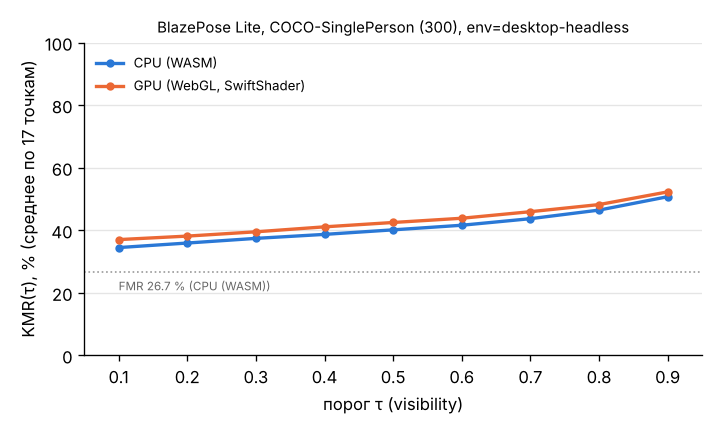

# Этап 0 — отчёт по прототипу (BlazePose Lite, COCO-SinglePerson, 300 изображений)

Дата: 30.10.2026. Окружение: **`env=desktop-headless`**, облачная виртуальная машина (4 vCPU), Chromium 153.0.8010.12 headless через Playwright 1.63.0. **Скорость ниже — проверка стенда, не результат для телефонов.**

Источники чисел (все — из реальных прогонов):
- сырые результаты: `results/raw/20261030-114815_cloud-desktop_blazepose-lite_wasm.json` (CPU/WASM), `results/raw/20261030-114857_cloud-desktop_blazepose-lite_webgl.json` (GPU/WebGL, программный SwiftShader);
- агрегаты: `data/accuracy_prototype_desktop-headless.csv`, `data/missing_prototype_desktop-headless.csv`, `data/perf_prototype_desktop-headless.csv`;
- расчёт: `python3 -I eval/evaluate.py --gt datasets/coco/single/gt_sub300_seed20261030.json --images datasets/coco/val2017 --tag prototype results/raw/<оба файла>`.

Конфигурация: `@mediapipe/tasks-vision` 1.1.1, `pose_landmarker_lite.task` (float16, SHA-256 `59929e1d…690d574a`), режим IMAGE, `numPoses = 1`, пороги MediaPipe по умолчанию (0,5). Выборка: 300 из 921 изображения COCO-SinglePerson, seed 20261030 (`docs/datasets.md`). Приведение 33 → 17 — по Таблице 4 статьи.

## 1. Метрики

| Метрика | CPU (WASM) | GPU (WebGL, SwiftShader) |
|---|---|---|
| OKS-AP | **0,311** (95 % ДИ 0,271–0,355) | 0,306 (0,266–0,348) |
| AP50 / AP75 | 0,566 / 0,293 | 0,543 / 0,305 |
| AR | 0,360 | 0,355 |
| PCK@0,2 (пропуск = ошибка) | 0,669 | 0,647 |
| PCK@0,2 (только найденные) | 0,785 | 0,793 |
| Норм. ошибка точки, медиана / p95 (доли L) | 0,079 / 0,731 | 0,079 / 0,756 |
| FMR (кадры без человека) | 26,7 % (80 из 300) | 29,7 % (89 из 300) |
| KMR(0,5), среднее по 17 точкам | 40,1 % | 42,5 % |
| Площадь под KMR(τ), τ = 0,1…0,9 (норм.) | 0,408 | 0,430 |
| Перестановки лево/право (OKS лучше после обмена) | 16 из 220 найденных | 16 из 211 |
| Задержка p50 / p95, мс (50 прогревов + 200 замеров) | 65,0 / 90,5 | 601,0 / 698,4 |
| Холодный старт: загрузка модели / инициализация / первый инференс, мс | 47 / 362 / 370 | 41 / 370 / 4384 |
| Размер модели | 5,78 МБ | 5,78 МБ |

Примечания:
- ДИ для AP — бутстреп по изображениям, 2000 выборок (не кластерный: на COCO одно изображение = один человек).
- PCK@0,2: L — бо́льшая из диагоналей торса (плечо — противоположное бедро) по разметке; считается на 212 из 300 изображений, где размечена хотя бы одна диагональ.
- Оценка экземпляра для AP — среднее `visibility` по 17 точкам (`score_source = visibility`). С постоянной оценкой 1,0 AP на CPU = 0,247 (проверочный расчёт на пробном прогоне `..._114626_smoke_...`, выходы модели совпадают): ранжирование по visibility полезно.
- Холодный старт — один замер на бэкенд (новый процесс браузера, модель с локального сервера, т. е. без сети). Первый процесс после запуска машины дал инициализацию 1097 мс (пробный прогон) — файловый кеш ОС не прогрет; для телефонов нужна серия замеров.
- Задержка — вызов `detect()` целиком (пред-/постобработка, синхронное получение точек), декодирование JPEG вне замера; изображения разного размера (по кругу 20 изображений).

**Сравнение с опубликованным.** В RTMPose (Jiang et al., 2023, Табл. 5) для BlazePose Lite на COCO-SinglePerson (1045 изобр.) AP = 29,3. Наш результат 31,1 (ДИ 27,1–35,5) на 300 изображениях — того же порядка; выборки различаются (у нас правило R2.1, 921 изобр.; см. `docs/datasets.md`), версия MediaPipe и способ оценки экземпляра в статье RTMPose не указаны. Признаков ошибки стенда нет (раздел 4).

## 2. Полнота: KMR(τ)

| τ | 0,1 | 0,2 | 0,3 | 0,4 | 0,5 | 0,6 | 0,7 | 0,8 | 0,9 |
|---|---|---|---|---|---|---|---|---|---|
| KMR, CPU | 34,5 % | 35,9 % | 37,4 % | 38,7 % | 40,1 % | 41,6 % | 43,7 % | 46,4 % | 50,7 % |
| KMR, GPU | 37,0 % | 38,1 % | 39,5 % | 41,1 % | 42,5 % | 43,8 % | 45,9 % | 48,2 % | 52,3 % |

KMR_j(0,5) по суставам (CPU): голова 27,3 %, плечи 27,7 %, бёдра (таз) 37–38 %, локти 44–46 %, запястья 44–45 %, колени 55–56 %, голеностопы 62–64 %. Полные таблицы по суставам — `data/missing_prototype_desktop-headless.csv`.

Наблюдения:
- Нижняя граница KMR задаётся FMR (26,7 %): в COCO-SinglePerson много мелких и частично видимых людей, на которых детектор BlazePose не срабатывает при пороге 0,5 (медианная доля площади человека в кадре: 0,059 у пропущенных против 0,120 у найденных — по пробному прогону).
- Порог τ*, выровненный по 10 % пропусков, на COCO **не определён**: KMR ≥ FMR > 10 % при любом τ. На собственных видео (человек в кадре целиком) τ* будет осмыслен; на COCO стоит дополнительно считать KMR среди кадров с найденным человеком — предложение для протокола.
- Нижние конечности теряются чаще — ожидаемо для COCO (обрезанные кадры), для КР-упражнений лёжа/сидя это требует отдельной проверки.

## 3. Пять худших изображений (CPU/WASM, по OKS среди найденных)

| image_id | OKS | размечено точек | Что произошло |
|---|---|---|---|
| 38048 | 0,00 | 15 | ложная детекция на пожарном гидранте; реальный человек мелкий, в глубине кадра |
| 415748 | 0,00 | 13 | скелет «натянут» на голову и хобот слона, всадник пропущен |
| 580294 | 0,00 | 3 | человек обрезан краем кадра; модель нашла «позу» на руке/посуде |
| 259097 | 0,01 | 14 | мелкий человек вдали (малая площадь → OKS очень чувствителен к сдвигу) |
| 576052 | 0,01 | 14 | всадник: скелет продлён на ноги лошади |

Рисунки: `docs/img/worst_wasm_{38048,415748,580294,259097,576052}.jpg` (зелёный — разметка, оранжевый — модель); для GPU — `docs/img/worst_webgl_*.jpg`. Все пять — ошибки модели (ложная или «склеенная» детекция), а не стенда.

## 4. Замечания по стенду

1. **Порядок и стороны точек (R1.4) проверены**: с картой по Таблице 4 AP = 0,311, с переставленными сторонами — 0,002; обмен сторон улучшает OKS лишь у 16 из 220 найденных людей. Значит, `left_*` в MediaPipe Tasks 1.1.1 — анатомическая левая сторона, как в COCO; `TODO` в примечании к Таблице 4 статьи можно закрыть.
2. **Нормировка координат**: выход MediaPipe нормирован к размерам кадра, перевод в пиксели — умножение на ширину/высоту исходного изображения. Предупреждение MediaPipe `NORM_RECT without IMAGE_DIMENSIONS` не влияет на результат: средний OKS на неквадратных кадрах не ниже, чем на квадратных.
3. **WASM детерминирован**: три прогона CPU (`..._114626_smoke_...`, `..._114815_...`, `..._120542_smoke-refactor_...`) дали бит в бит одинаковые точки на общих изображениях.
4. **CPU и GPU дают разные точки** на одних и тех же кадрах: 19 изображений расходятся по факту детекции, медиана максимального расхождения координат — 17,8 px. GPU здесь — программный SwiftShader; на реальных GPU телефонов расхождение может быть другим (ср. пониженную точность WebGL [@smilkov2019tensorflowjs]). Нужна сверка на телефоне и с Python-эталоном (R1.5, этап 1).
5. **Скорость GPU в облаке не показательна**: SwiftShader эмулирует GPU на CPU (p50 601 мс против 65 мс на WASM; первый инференс 4,4 с — предположительно компиляция шейдеров).
6. Пороги детекции MediaPipe (0,5) — вероятный главный источник FMR (влияние не измерялось). Предлагаю зафиксировать их явно в протоколе и оставить значения по умолчанию (так работает приложение); чувствительность AP/FMR к порогу — отдельный прогон.
7. Бутстреп-ДИ широкие (±4 п. п.) — для статьи нужен прогон на всей выборке (921).

## 5. Что дальше
- Прогон на полной COCO-SinglePerson (921) и вариант 1045 для прямого сравнения с RTMPose.
- Замеры на телефонах — `docs/phone_quickstart.md`.
