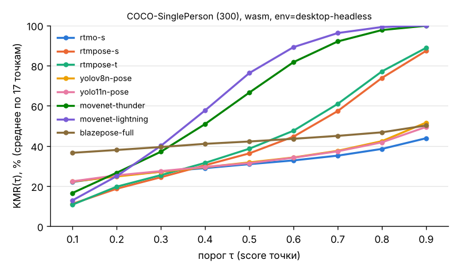

# Этап 1 — отчёт: стенд для нескольких моделей

Дата: 30.10.2026. **`env=desktop-headless`**: облачная ВМ (4 vCPU), Chromium 153 headless (Playwright 1.63). GPU в облаке программный (SwiftShader). **Скорость — проверка стенда, не результат для телефонов.**

Данные: 300 изображений COCO-SinglePerson (seed 20261030, `docs/datasets.md`). Модели и веса — `docs/models.md`, `models/manifest.json`. Прогоны — одна матрица, пары по очереди в отдельных процессах браузера, порядок перемешан (seed 2), 50 прогревов + 200 замеров на 20 изображениях; список — `logs/runs.md` (30.10.2026, 15:34–16:28), сырые файлы — `results/raw/20261030-15*.json`, `20261030-16*.json`. Агрегаты: `data/accuracy_stage1_desktop-headless.csv`, `data/missing_stage1_desktop-headless.csv`, `data/perf_stage1_desktop-headless.csv` (`python3 -I eval/evaluate.py --tag stage1 …`, бутстреп AP — 2000 выборок).

## 1. Точность и полнота (CPU / WASM)

| Модель | Рантайм | AP (95 % ДИ) | AP50 | AR | PCK@0,2 | PCK@0,2 найд. | FMR | KMR(0,5) |
|---|---|---|---|---|---|---|---|---|
| RTMO-s | ORT Web | **0,755** (0,720–0,790) | 0,917 | 0,775 | 0,927 | 0,931 | 0,3 % | 30,9 % |
| RTMPose-s + RTMDet-nano | ORT Web | 0,701 (0,662–0,740) | 0,890 | 0,748 | 0,912 | 0,920 | 1,7 % | 36,3 % |
| RTMPose-t + RTMDet-nano | ORT Web | 0,639 (0,601–0,682) | 0,869 | 0,700 | 0,892 | 0,899 | 1,7 % | 38,6 % |
| YOLOv8n-pose | ORT Web | 0,587 (0,550–0,629) | 0,876 | 0,646 | 0,865 | 0,879 | 4,0 % | 31,8 % |
| YOLO11n-pose | ORT Web | 0,550 (0,510–0,594) | 0,855 | 0,615 | 0,843 | 0,854 | 2,7 % | 31,4 % |
| MoveNet Thunder | TF.js | 0,485 (0,441–0,531) | 0,751 | 0,542 | 0,801 | 0,801 | 0 %* | 66,5 % |
| MoveNet Lightning | TF.js | 0,340 (0,300–0,383) | 0,603 | 0,405 | 0,697 | 0,697 | 0 %* | 76,3 % |
| BlazePose Heavy | MediaPipe | 0,433 (0,391–0,484) | 0,620 | 0,473 | 0,735 | 0,874 | 27,3 % | 44,7 % |
| BlazePose Full | MediaPipe | 0,375 (0,332–0,426) | 0,588 | 0,427 | 0,709 | 0,846 | 28,0 % | 42,2 % |
| BlazePose Lite | MediaPipe | 0,311 (0,271–0,355) | 0,566 | 0,360 | 0,669 | 0,785 | 26,7 % | 40,1 % |
| *диагностика:* MoveNet Thunder, 2 прохода | TF.js | 0,645 (0,605–0,687) | 0,836 | 0,675 | 0,897 | 0,897 | 0 %* | 56,7 % |
| *диагностика:* MoveNet Lightning, 2 прохода | TF.js | 0,526 (0,486–0,569) | 0,763 | 0,568 | 0,843 | 0,843 | 0 %* | 65,4 % |

\* MoveNet SinglePose всегда возвращает человека — FMR = 0 по построению, неинформативен.

Наблюдения:
- **Уверенность моделей не сопоставима между семействами**: кривые KMR(τ) пересекаются (MoveNet даёт низкие score точек, BlazePose — высокие, но теряет людей целиком). Сравнивать KMR при одном τ некорректно — это подтверждает выбор порога τ*, выровненного по доле пропусков (раздел 3.4 статьи). На COCO τ* по 10 % не определён ни для одной модели: даже при τ = 0,1 KMR ≥ 11 %. Для собственных видео это нужно перепроверить.
- **BlazePose теряет человека на 27–28 % изображений** (детектор, порог 0,5); среди найденных PCK у Heavy (0,874) сопоставим с RTMPose. Остальные модели почти не теряют людей (FMR ≤ 4 %).
- Перестановки лево/право (обмен улучшает OKS): от 9 (RTMO-s, BlazePose Full/Heavy) до 43 (MoveNet Lightning) из 300.
- WebGL даёт ту же точность, что WASM, с точностью до шума (BlazePose: −0,4…−0,6 п. AP и +1–3 п. FMR — расхождение GPU-делегата, см. сверку ниже; MoveNet — совпадение до 3-го знака).

**Сравнение с публикациями (ориентир, не подгонка):**

| Модель | Наш AP (300) | Опубликовано | Комментарий |
|---|---|---|---|
| BlazePose Lite / Full | 0,311 / 0,375 | 29,3 / 35,4 (RTMPose, Табл. 5) | совпадает по порядку |
| MoveNet Lightning / Thunder | 0,340 / 0,485 | 53,6 / 64,8 (там же) | расхождение 16–19 п.; со вторым проходом по кропу — 0,526 / 0,645, т. е. совпадает: разница в протоколе, а не ошибка стенда (`research/progress/bench-tfjs.md`) |
| RTMPose-t / -s | 0,639 / 0,701 | 72,1 / — (там же, COCO-only) | у нас веса body7 (решение автора), разница < 10 п. |
| YOLOv8n/11n-pose | 0,587 / 0,550 | 50,4 / 50,0 mAP (Ultralytics, весь val2017, многочеловечный) | другие выборка и протокол — не сопоставимо напрямую |

## 2. Скорость и холодный старт (облачный ПК, не телефон)

| Модель | Бэкенд | p50 / p95, мс | Загрузка модели / иниц. / 1-й инференс, мс | Размер, МБ |
|---|---|---|---|---|
| MoveNet Lightning | WASM | 34,5 / 52,8 | 94 / 72 / 203 | 4,82 |
| BlazePose Lite | WASM | 59,0 / 85,8 | 44 / 316 / 273 | 5,78 |
| RTMPose-t (+ детектор) | WASM | 65,5 / 86,0 | 139 / 526 / 308 | 17,36 |
| BlazePose Full | WASM | 75,4 / 116,0 | 40 / 390 / 278 | 9,40 |
| RTMPose-s (+ детектор) | WASM | 80,0 / 110,8 | 127 / 536 / 219 | 25,90 |
| MoveNet Thunder | WASM | 80,2 / 109,9 | 136 / 73 / 269 | 12,65 |
| BlazePose Heavy | WASM | 224,8 / 330,7 | 155 / 600 / 452 | 30,66 |
| YOLO11n-pose | WASM | 235,9 / 316,9 | 68 / 538 / 357 | 11,85 |
| YOLOv8n-pose | WASM | 236,9 / 345,5 | 86 / 437 / 318 | 13,51 |
| RTMO-s | WASM | 584,1 / 692,7 | 190 / 646 / 725 | 39,62 |
| *MoveNet Lightning / Thunder, 2 прохода* | WASM | 54,3 / 76,1; 163,4 / 215,7 | | |
| BlazePose Lite / Full / Heavy | WebGL (SwiftShader) | 564 / 715 / 2031 (p50) | первый инференс 3,7 / 4,9 / 7,7 с | |
| MoveNet Lightning / Thunder | WebGL (SwiftShader) | 225 / 656 (p50) | первый инференс 4,4 / 4,9 с | |

- Загрузка модели — с локального сервера (без сети); на телефоне холодный старт определяется сетью (этап 0: 67 с на 4G).
- WebGPU (SwiftShader) в облаке непригоден: RTMPose-t ≈ 9,4 с, RTMPose-s ≈ 6,5 с на кадр; YOLO и RTMO не уложились в 10 мин (первый инференс 39–89 с); MoveNet Lightning — 1,7 с/кадр. WebGPU — только на телефоне/реальном GPU.
- Вход 640×640 у YOLO и RTMO делает их на CPU в 3–9 раз медленнее RTMPose-t при сопоставимой или лучшей точности — кандидаты на вход 320 (`TODO(автор)`) и на WebGPU.

## 3. Сверка с эталоном (R1.5)

| Пара | Изобр. | Совпадение детекции | Расхождение точек, px (медиана / среднее / p95) | AP браузер / эталон |
|---|---|---|---|---|
| BlazePose Lite WASM ↔ MediaPipe Python 1.1.1 | 300 | 217 оба; 3 / 2 только одна сторона | 0,007 / 2,6 / 6,9 | 0,311 / 0,317 |
| BlazePose Lite WebGL (SwiftShader) ↔ Python | 300 | 205 оба; 6 / 14 | 4,1 / 11,3 / 41,4 | 0,305 / 0,317 |
| YOLOv8n-pose WASM ↔ ultralytics 8.3.253 (тот же ONNX) | 50 | 48 оба; 0 расхождений | 0,5 / 2,3 / — (макс. 74,8) | — |

`TODO`: эталон для MoveNet (TF Python) и RTMPose/RTMO (rtmlib) — не сделан; для RTMPose заодно проверить порядок каналов (на 50 изобр. BGR дал AP 0,698 против 0,668 при RGB по `pipeline.json`; разница в пределах шума, не подтверждена).

## 4. Замечания по стенду
1. Адаптеры: `bench/adapters/{mediapipe,tfjs,ort}.js`, реестр — `bench/adapters/registry.js`; пороги и пред-/постобработка — `research/progress/bench-{mediapipe,tfjs,ort}.md`. Оценка экземпляра: BlazePose — среднее visibility, MoveNet — среднее score точек, ORT-модели — score детекции.
2. WASM детерминирован (повторные прогоны BlazePose Lite совпадают бит в бит; AP в матрице = AP этапа 0).
3. Агенты в ходе разработки запускали прогоны параллельно — их задержки не использованы; все числа выше — из последовательной матрицы.
4. Готовность этапа 1 (`PLAN.md`): все обязательные модели прошли ≥ 200 изображений хотя бы на одном бэкенде — **да**; расхождение с эталоном задокументировано — **частично** (BlazePose, YOLO; MoveNet и RTMPose — TODO).

## 5. Решения автора, нужные дальше
- MoveNet: основной протокол — один проход (как видеорежим библиотеки) или второй проход по кропу (как в публикации).
- YOLO/RTMO: вход 320 (дополнительно к 640)?
- Страница телефона для всех моделей (этап 4) — сейчас она только для BlazePose Lite.
